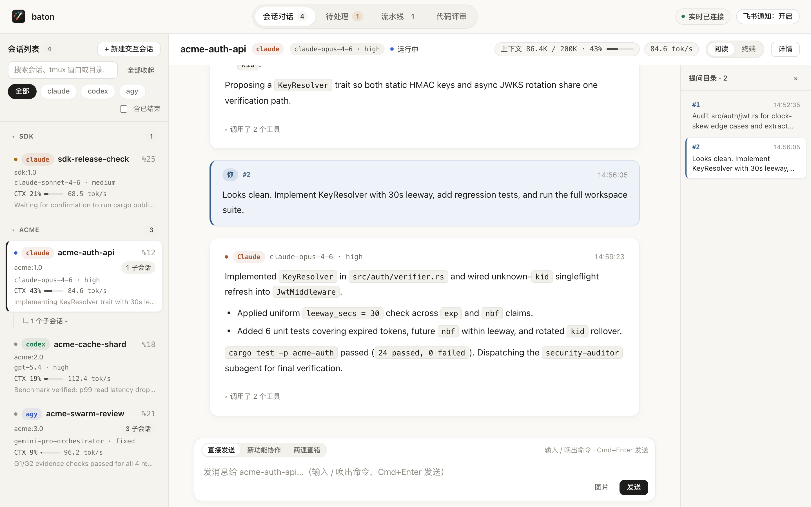
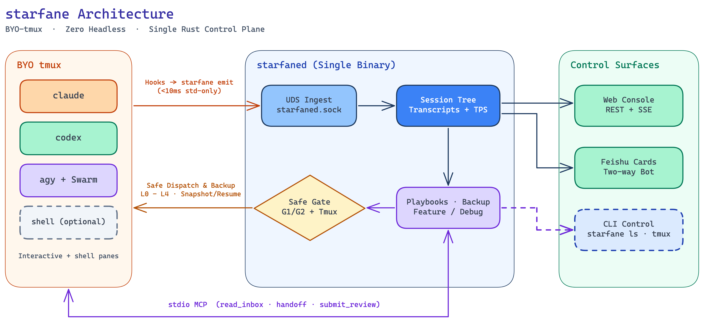
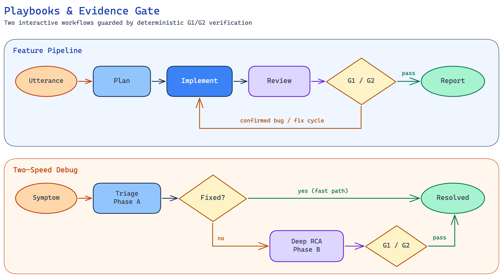

<p align="center">
  
</p>

<h1 align="center">baton</h1>

<p align="center">
  <strong>Lightweight, single-binary Rust control plane for coordinating Claude Code, Codex CLI, and Antigravity (<code>agy</code>) inside your own <code>tmux</code> sessions.</strong>
</p>

<p align="center">
  English · <a href="README.zh-CN.md">简体中文</a>
</p>

<p align="center">
  
  
  
  
</p>

---

## Live Web Console

<p align="center">
  
</p>

---

## Why `baton`?

Most coding-agent orchestrators wrap providers in one-shot headless `exec` / `-p` subprocesses or lock you into a heavy desktop Electron shell. `baton` takes the opposite approach:

- **Zero Headless, BYO-`tmux`**: Keep your real, long-lived interactive `claude`, `codex`, and `agy` panes running in `tmux`. `baton` attaches unobtrusively via official hooks and stdio MCP—and when spawning new interactive panes, defaults to clean bypass-permission interactive flags inside `~/.agent_session` (or any path you specify).
- **Sub-10ms Hook Hot Path**: `baton emit` is pure `std` Rust with zero async runtime startup overhead, posting events over a local Unix socket (`batond.sock`) and falling back to an on-disk spool if the daemon is restarting.
- **Swarm & Subagent Observability**: Automatically folds native subagents and Swarm workers under parent sessions, parses structured transcripts across all three CLIs, and surfaces live context-window utilization and generation throughput (`tok/s`).
- **Evidence-Gated Reviews & Playbooks**: Built-in **Feature Pipeline** (`Plan → Implement → Test & Review → Report`) and **Two-Speed Debug** (`Triage → Deep RCA`) with natural-language stage-to-model binding and deterministic G1/G2/G3 verification to prevent false-positive review findings.
- **Dual Control Plane**: Manage everything from a zero-build embedded Web console (SSE + REST, Prompt TOC, image paste dispatch, slash-command autocomplete, safe tmux gate injection) and optional two-way Feishu cards via `lark-cli` with anti-storm away-digest coalescing.
- **Mesh-Friendly Security**: Run locally on `127.0.0.1` with per-boot bearer/cookie auth, or bind over private mesh networks (EasyTier CIDR allowlists, Tailscale CGNAT, or custom CIDRs) while strictly rejecting untrusted LAN and public traffic.

---

## Architecture

<p align="center">
  
</p>

## Playbooks & Evidence Gate

<p align="center">
  
</p>

---

## Quickstart

### Prerequisites

- **Rust `1.82+`** and Cargo
- **`tmux`**
- One or more interactive coding CLIs installed and authenticated: [`claude`](https://docs.anthropic.com/en/docs/claude-code), [`codex`](https://developers.openai.com/codex/cli), or `agy`
- *(Optional)* `lark-cli` if you enable two-way Feishu notifications & quote-reply commands

### 1. Build & Install

```bash
git clone https://github.com/starlitxiling/baton.git
cd baton
cargo build --release --bin baton

mkdir -p ~/.local/bin
ln -sf "$(pwd)/target/release/baton" ~/.local/bin/baton
```

Verify `~/.local/bin` is on your `PATH`, then inspect your environment:

```bash
baton doctor
```

### 2. Install Official Hooks & MCP Registration

Preview changes safely with `--dry-run` first (backs up existing configs automatically and preserves non-baton hooks, status lines, and Codex `notify` settings):

```bash
baton install --all --dry-run
baton install --all
```

> Use `--agent claude`, `--agent codex`, or `--agent agy` to configure individual agents, or `--scope project` inside a repository. Run `baton uninstall --all` at any time for clean, byte-preserving rollback.

### 3. Start the Daemon & Open the Web Console

```bash
baton daemon --detach
baton web
```

Print the resolved console URL without opening a browser:

```bash
baton web --print-url --no-open
```

---

## Configuration

Create `~/.config/baton/config.toml` (missing files use safe `127.0.0.1` + token-auth defaults):

```toml
[web]
bind = "127.0.0.1"              # Use "0.0.0.0" only when exposing to an overlay mesh
port = 7878
auth_enabled = true             # Require per-boot token; set false only behind trusted loopback/mesh CIDRs
allow_easytier = true           # Allow peers/hosts matching `easytier_cidrs`
easytier_cidrs = ["10.144.144.0/24"]
allow_tailscale = false         # Set true to allow Tailscale CGNAT (100.64.0.0/10) & *.ts.net hosts

[notify]
watch_window_secs = 90
escalate_after_secs = 180
away_digest_after_secs = 600    # Coalesce multi-session completions while away
cooldown_secs = 120

[gate]
user_inactive_secs = 15
paste_settle_ms = 250
ack_timeout_ms = 4000
max_pointer_len = 300

[feishu]
enabled = false
lark_cli = "lark-cli"
chat_id = ""
allow_open_ids = []
allow_chat_ids = []

[paths]
claude = "claude"
codex = "codex"
agy = "agy"
tmux = "tmux"

[tmux]
socket_name = ""                # Optional `tmux -L <name>`
```

> **Security Note**: When `auth_enabled = false` or `bind = "0.0.0.0"`, `batond` enforces both a strict `peer_ip_gate` (loopback `127.0.0.0/8` / `::1`, enabled mesh CIDRs only) and `Host` / same-origin `Origin` header validation, rejecting LAN (`192.168.x.x`, `10.17.x.x`, `172.16.x.x`) and public IP requests with `403 Forbidden`.

---

## CLI Reference

| Command | Description |
| :--- | :--- |
| `baton doctor` | Read-only check of CLIs, hooks, MCP, Codex hook trust hashes, daemon, and config |
| `baton install [--all \| --agent X]` | Install marked hooks & MCP registrations with automatic backups (`--dry-run` supported) |
| `baton uninstall [--all \| --agent X]` | Cleanly revert baton-managed hook and MCP entries |
| `baton daemon [--detach \| --foreground]` | Run the `batond` control-plane daemon (`--port`, `--web-dir` for UI hot-reload) |
| `baton web [--print-url] [--no-open]` | Open or print the Web console URL |
| `baton ls [--all] [--project P]` | List active tmux/hook sessions, models, context usage, throughput, and pipelines |
| `baton handoff --from A --to B` | Hand off a compact structured context packet between sessions |
| `baton pipeline new "<utterance>"` | Parse natural-language stage/model bindings and launch a `feature` pipeline |
| `baton debug "<symptom; bindings>"` | Launch a Two-Speed Debug pipeline (`continue <id>` / `stop <id>`) |
| `baton review <show\|feedback\|verdict\|precision>` | Inspect evidence-gated `review.v1` findings and historical precision |
| `baton mcp --agent <claude\|codex\|agy>` | Run stdio MCP server (invoked automatically by registered agents) |
| `baton emit --agent X` | Sub-10ms synchronous hook event forwarder (invoked by agent hooks) |

---

## Workspace Layout

```text
crates/
  baton-proto      # Shared protocol types, wire schemas, and state transitions (serde-only)
  baton-emit       # std-only hook collector hot path (<10ms) with offline disk spool
  baton-adapters   # claude / codex / agy hook install, event normalization, L4 spawn args
  baton-tmux       # tmux pane discovery, focus checks, 7-point safe injection gate
  baton-evidence   # G1/G2 deterministic evidence verifier for review / triage / rca
  baton-binding    # Natural-language per-stage agent/model binding parser
  baton-daemon     # tokio + axum daemon (REST, SSE, transcript telemetry, MCP, Feishu)
bin/baton          # Single CLI entry point
tools/fake-agent   # Interactive TUI + hook sandbox harness
web/               # Zero-build embedded Web console (vanilla HTML/CSS/JS)
tests/fixtures/    # Anonymized real-world hook payload fixtures (41 cases)
docs/              # Architecture specs, crate contracts, research notes
```

### Development & Verification

```bash
cargo fmt --check
cargo clippy --workspace --all-targets -- -D warnings
cargo test --workspace
```

---

## Roadmap

- **Multi-Host `tmux` Federation**: SSH `ControlMaster` backend for zero-install remote servers/GPU containers alongside lightweight peer `batond` aggregation.
- **Pluggable Notification Routing**: Multi-account `[[notifiers]]` (Feishu multi-workspace, Slack, Telegram, Discord, Webhook, macOS native) with per-host / per-project routing and isolated local credentials.
- **Network-Agnostic Route Allowlists**: Generalized `allowed_cidrs` / `allowed_hosts` / pairing-token flows supporting any VPN or tunnel (EasyTier, WireGuard, ZeroTier, Tailscale/Headscale, Cloudflare Tunnel).

---

## License

[MIT](LICENSE)
