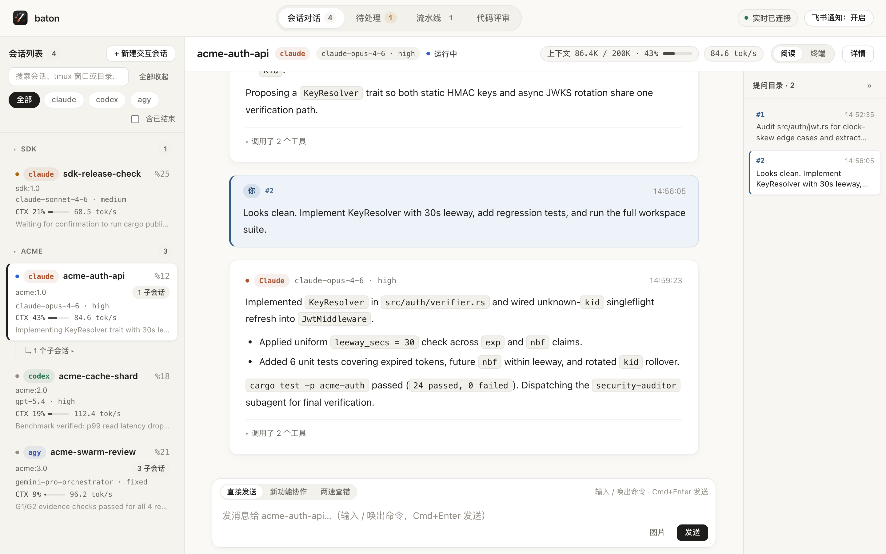
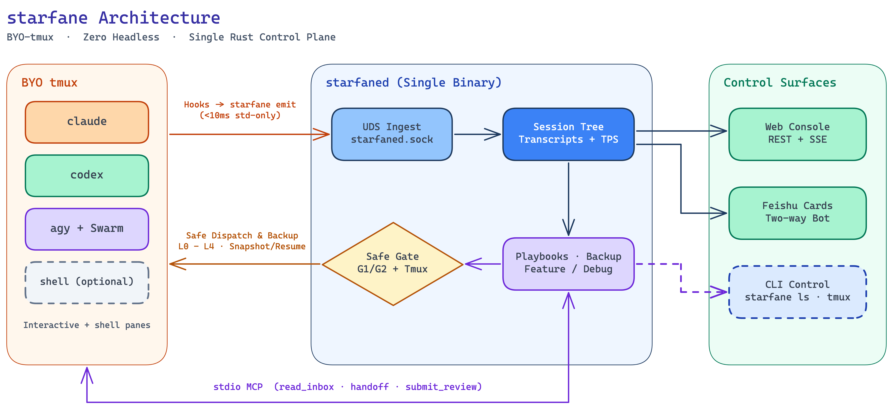
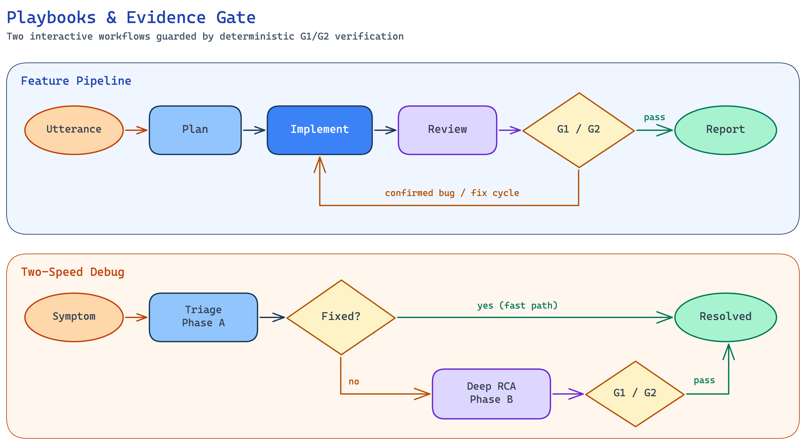

<p align="center">
  
</p>

<h1 align="center">baton</h1>

<p align="center">
  <strong>轻量级 Rust 单二进制多 Agent 控制面：直接在你自己的 <code>tmux</code> 会话中统一编排 Claude Code、Codex CLI 与 Antigravity (<code>agy</code>)。</strong>
</p>

<p align="center">
  <a href="README.md">English</a> · 简体中文
</p>

<p align="center">
  
  
  
  
</p>

---

## Web 控制台预览

<p align="center">
  
</p>

---

## 核心特性

- **零 Headless · BYO-`tmux`**：不强迫使用一次性的无头子进程，继续保留你在 `tmux` 中长期运行的交互式 `claude`、`codex` 与 `agy` 窗格；新建交互会话默认安全携带全权限参数与统一目录 `~/.agent_session`（指定目录时尊重用户目录）。
- **亚 10ms Hook 热路径**：`baton emit` 仅依赖 Rust 标准库（无异步运行时冷启动开销），通过本地 UDS（`batond.sock`）上报事件，守护进程重启期间自动落盘 spool 补传。
- **Swarm 与子会话树可观测**：自动折叠父子会话与 Swarm Worker，解析三家结构化 JSONL 对话记录，实时展示上下文占比与生成速度（`tok/s`）。
- **防误报证据门禁（Review & Two-Speed Debug）**：内置 **新功能协作（Feature Pipeline）** 与 **两速查错（Two-Speed Debug）**，支持自然语言阶段模型绑定（如「计划用 Claude，实现用 Codex，评审用 AGY /swarm」）及确定性 G1/G2/G3 证据核验。
- **双控制面 + 防风暴通知**：内嵌零构建 Web 控制台（REST + SSE、右侧提问目录、图片粘贴投递、斜杠命令补全、7 重安全注入门禁），以及支持话题续聊、自定义静音和离开汇总防轰炸的飞书双向控制（`lark-cli`）。
- **私有组网友好**：默认绑定 `127.0.0.1` + Token 鉴权；支持无缝接入 EasyTier、Tailscale 或自定义 CIDR 私有组网，同时在网关层严格拦截未授权的普通局域网与公网访问（`403`）。

---

## 系统架构

<p align="center">
  
</p>

## 两大工作流与证据门禁

<p align="center">
  
</p>

---

## 快速开始

### 环境准备

- **Rust `1.82+`** 与 Cargo
- **`tmux`**
- 已安装并登录至少一个编码 Agent CLI：[`claude`](https://docs.anthropic.com/en/docs/claude-code)、[`codex`](https://developers.openai.com/codex/cli) 或 `agy`
- *（可选）* `lark-cli`（若需要飞书双向卡片通知）

### 1. 编译与安装

```bash
git clone https://github.com/starlitxiling/baton.git
cd baton
cargo build --release --bin baton

mkdir -p ~/.local/bin
ln -sf "$(pwd)/target/release/baton" ~/.local/bin/baton
```

确认 `~/.local/bin` 已在 `PATH` 中，并执行自检：

```bash
baton doctor
```

### 2. 安装官方 Hook 与 MCP

先用 `--dry-run` 预览配置变更（实际写入时会自动备份原文件，严格保留非 baton 的现有 hooks 与 Codex `notify`）：

```bash
baton install --all --dry-run
baton install --all
```

> 也可通过 `--agent claude|codex|agy` 单独安装，或 `--scope project` 仅安装到当前仓库；随时可执行 `baton uninstall --all` 完整无损回滚。

### 3. 启动守护进程并打开控制台

```bash
baton daemon --detach
baton web
```

仅打印解析后的控制台地址而不拉起浏览器：

```bash
baton web --print-url --no-open
```

---

## 配置参考（`~/.config/baton/config.toml`）

```toml
[web]
bind = "127.0.0.1"              # 若通过私有组网对其他设备开放可设为 "0.0.0.0"
port = 7878
auth_enabled = true             # 设为 false 时将仅放行本机回环与显式开启的组网 CIDR
allow_easytier = true           # 放行匹配 easytier_cidrs 的对等端访问
easytier_cidrs = ["10.144.144.0/24"]
allow_tailscale = false         # 若使用 Tailscale，可设为 true（放行 100.64.0.0/10 与 *.ts.net）

[notify]
watch_window_secs = 90
escalate_after_secs = 180
away_digest_after_secs = 600    # 离开电脑期间聚合多会话完成通知，防止卡片轰炸
cooldown_secs = 120

[gate]
user_inactive_secs = 15
paste_settle_ms = 250
ack_timeout_ms = 4000
max_pointer_len = 300

[feishu]
enabled = false
lark_cli = "lark-cli"
chat_id = ""
allow_open_ids = []
allow_chat_ids = []

[paths]
claude = "claude"
codex = "codex"
agy = "agy"
tmux = "tmux"

[tmux]
socket_name = ""                # 可选 `tmux -L <name>`
```

> **安全说明**：当 `auth_enabled = false` 或 `bind = "0.0.0.0"` 时，`batond` 会同时校验连接来源 IP（`peer_ip_gate`）与 HTTP `Host` / 同源 `Origin`，仅放行本机回环与配置白名单网段，普通局域网（`192.168.x.x`、`10.17.x.x`、`172.16.x.x`）与公网请求将直接返回 `403`。

---

## CLI 常用命令

| 命令 | 说明 |
| :--- | :--- |
| `baton doctor` | 只读检查 Agent CLI、Hook、MCP、Codex 信任哈希、守护进程与配置 |
| `baton install [--all \| --agent X]` | 安装带标记的 Hook 与 MCP（支持 `--dry-run`，自动备份原配置） |
| `baton uninstall [--all \| --agent X]` | 干净还原 baton 写入的配置条目 |
| `baton daemon [--detach \| --foreground]` | 启动 `batond` 守护进程（支持 `--port`、`--web-dir` 前端热重载） |
| `baton web [--print-url] [--no-open]` | 打开或打印当前 Web 控制台地址 |
| `baton ls [--all] [--project P]` | 列出活跃会话、状态、模型、上下文占比、TPS 与流水线 |
| `baton handoff --from A --to B` | 在两个会话之间投递结构化上下文交接包 |
| `baton pipeline new "<说明>"` | 解析自然语言阶段/模型绑定并拉起 Feature 工作流 |
| `baton debug "<现象; 绑定>"` | 启动两速查错流程（支持 `continue <id>` / `stop <id>`） |
| `baton review <show\|feedback\|verdict\|precision>` | 查看带证据校验的评审结论与历史误报率 |

---

## 仓库结构

```text
crates/
  baton-proto      # 共享协议类型、状态机转换与 Schema（纯 serde）
  baton-emit       # 纯 std Hook 热路径（<10ms）与离线 spool 落盘
  baton-adapters   # claude / codex / agy Hook 安装、事件归一化、L4 启动参数组装
  baton-tmux       # tmux 窗格发现、用户焦点探测、7 重安全注入门禁
  baton-evidence   # Review / Triage / RCA 的 G1/G2 确定性证据校验器
  baton-binding    # 自然语言工作流阶段-模型绑定解析器
  baton-daemon     # tokio + axum 控制面守护进程（REST/SSE、对话遥测、MCP、飞书）
bin/baton          # 单二进制 CLI 主入口
tools/fake-agent   # 交互式 TUI 与 Hook 沙箱测试工具
web/               # 零构建内嵌 Web 控制台（原生 HTML/CSS/JS）
tests/fixtures/    # 脱敏的真实 Hook 输入样例库（41 个用例）
docs/              # 架构文档、Crate 契约、环境与 Spike 调研笔记
```

### 本地校验

```bash
cargo fmt --check
cargo clippy --workspace --all-targets -- -D warnings
cargo test --workspace
```

---

## 后续路线图

- **多机远程 `tmux` 协同**：支持通过 SSH `ControlMaster` 免安装纳管云端服务器 / 临时 GPU 容器窗格，并支持主力开发机轻节点 `batond` 联邦接入。
- **多渠道与多账号隔离通知**：抽象统一 `Notifier` 接口（支持多套飞书账号/企业应用、Slack、Telegram、Discord、Webhook、macOS 原生提醒），支持按机器 / 项目路由，公司机与个人机凭证完全隔离。
- **组网无关通用访问层**：将 `allow_easytier` / `allow_tailscale` 升级为通用的 `allowed_cidrs` + `allowed_hosts` + 一次性配对鉴权，兼容 WireGuard、ZeroTier、Tailscale/Headscale、EasyTier、Cloudflare Tunnel 与 SSH 端口转发。

---

## 开源协议

[MIT](LICENSE)
