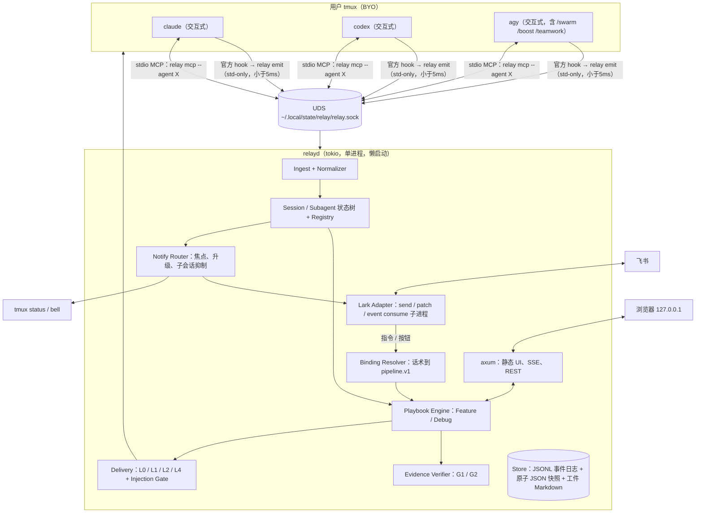
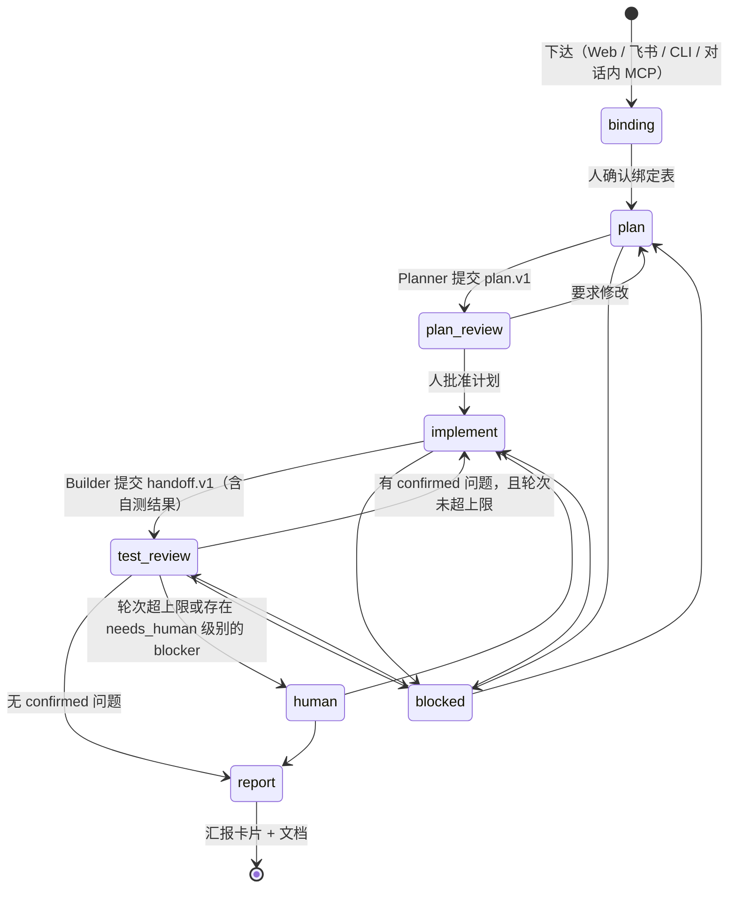
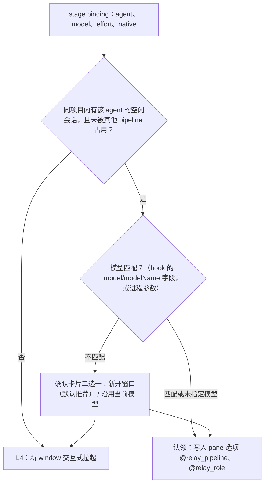
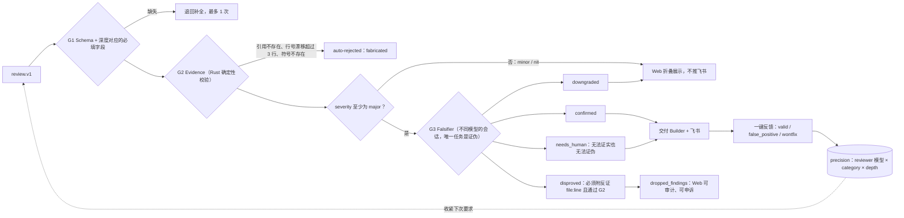

# relay v2 架构蓝图与协议规范

> 状态：**v2.1**（已融合 scout #18 `rust-and-env-check.md`、verifier Stage 1 备忘 #19 与 Stage 2 意见 #21、用户工作流约束 #17；待 verifier 签核）
> 前序：[research.md](./research.md)（平台实测）· [design-options.md](./design-options.md)（v1 选型记录）· [rust-and-env-check.md](./rust-and-env-check.md)（Rust 环境与多 Agent 实测）
> 用户决策：board #15（6 条硬方向）+ #17（两大一等工作流）。项目代号暂定 **`relay`**。

---

## 0. TL;DR

- relay 是一个 **Rust 单二进制**的本地中枢。它通过**官方 hook + MCP** 观察、调度你在 **tmux 中交互式运行**的 claude / codex / agy，**全程零 Headless**。
- 产品只围绕**两条一等工作流**：
  - **Feature Pipeline**：Plan → Implement → Test & Review → Report；
  - **Two-Speed Debug**：Phase A 快筛 → Phase B 深挖。
- 每个阶段用哪个 agent / 模型 / 原生模式，你可以用一句话指定（如「计划用 Claude，实现用 Codex，Review 用 agy /swarm」）。relay 把这句话解析成 `pipeline.v1` 绑定表，回显给你确认，然后**认领已有会话或在新 tmux window 中以交互模式拉起**对应会话。
- **双控制面**：内嵌 Web 控制台（127.0.0.1，SSE）+ 飞书双向（卡片通知、文本指令、按钮确认）。
- **`review.v1` 防误报**：深度档位 D0–D3 + 证据 / 触发路径必填 + 机器证据校验（G2）+ 跨模型反驳（G3）+ 误报率闭环。快筛和深挖的结论复用同一套证据校验器。
- 路线图 **M0–M4**，按 AI 开发速度估算，合计约 24–42 小时；每个阶段都有自动化门禁。

---

## 1. 定位与硬约束

| # | 硬约束 | 架构含义 |
|---|---|---|
| H1 | **零 Headless**：禁止把 `claude -p`、`codex exec`、`codex review`、`agy -p` 用作执行后端 | 所有工作都发生在 tmux 交互会话中；新会话一律以**交互模式 + 初始 prompt** 启动（L4，见 §5） |
| H2 | **BYO-tmux** | 只认领已有 pane，或**新建 window**；绝不重排用户的 pane |
| H3 | **只用官方扩展面**（Hook / MCP / 官方 CLI 子命令） | 不 patch 二进制、不读私有 IPC；抓屏只用于「是否变化 / 是否为空」这类门禁判断，不当数据通道 |
| H4 | **非侵入、可逆** | 安装时 dry-run、备份、只操作带标记的条目；codex 只写 `hooks.json`，永不碰 `notify` |
| H5 | **Rust 单二进制，磁盘可控** | 本机 SSD 仅剩 34Gi（scout §1.1），所以依赖精简、`emit` 路径只用 std、执行 Cargo 预算（§9） |
| H6 | **结论必须有证据** | review / triage / rca 都经过机器证据校验（§7） |

**非目标**：不做 tmux 替代品，不做通用工作流 DSL，不做远程多用户 SaaS。只做两条工作流，把它们做到极致。

---

## 2. 系统总体架构



### 2.1 子命令（同一个二进制）

| 子命令 | 生命周期 | 职责 | 约束 |
|---|---|---|---|
| `relay emit --agent X` | hook 调用 | 读 stdin，归一化后通过 UDS 发送（50ms 超时）；失败则写 spool 并 detached 拉起 relayd；**永远输出 adapter 指定的回复（agy 为 `{}`）并返回 0** | `main()` 先匹配到 `emit`，就走同步分支，**不构造 tokio runtime**（scout：冷启动小于 5ms） |
| `relay mcp --agent X` | 由 agent 拉起 | 手写的最小 stdio JSON-RPC MCP，是 relayd 的薄客户端 | 只实现 `initialize`、`notifications/initialized`、`ping`、`tools/list`、`tools/call` 5 个方法 |
| `relay daemon`（relayd） | 懒启动；可选 launchd | 状态、编排、Web、飞书、通知 | tokio + axum（最小 feature） |
| `relay install / uninstall / doctor` | 一次性 | 三家 hook + MCP 注册；环境与 trust 体检 | — |
| `relay feature / debug / ls / send / web` | 一次性 | 人用 CLI，与 Web / 飞书共用同一套 REST 语义 | — |

### 2.2 统一事件 `relay.event.v1`

```jsonc
{ "v":1, "id":"ulid", "ts":"RFC3339", "agent":"claude|codex|agy",
  "session":"<root session_id / conversationId>", "sub":"<agent_id|null>",
  "pane":"%12|null", "cwd":"/repo", "model":"<来自 hook 的 model/modelName，可空>",
  "kind":"session_start|working|turn_complete|needs_permission|needs_input|error|interrupted|session_end|subagent_start|subagent_end",
  "confidence":"exact|heuristic", "detail":{…}, "raw_ref":"<transcript_path>" }
```

原生事件到 `kind` 的映射沿用 design-options §5.2（verifier #9/#11 已核验）。

---

## 3. 两大一等工作流（Playbooks）

### 3.1 通用模型：`pipeline.v1`

两条工作流共用同一个数据结构：**阶段（stage）× 绑定（binding）× 门禁（gate）× 工件（artifact）**。

```toml
# .relay/pipelines/P-01JD….toml（relayd 生成，人和 agent 都可读；用 TOML 而非 YAML，不引入 serde_yaml）
id = "P-01JD…"
playbook = "feature"            # feature | debug
goal = "给 relay 加飞书静音命令"
status = "awaiting_binding_confirm"
project = { root = "/Users/…/proj", base_branch = "main", worktree = "auto" }
source = { via = "feishu", utterance = "计划用 Claude opus，实现用 Codex，Review 用 agy /swarm", operator = "ou_xxx" }

[[stages]]
id = "plan"
binding = { agent = "claude", model = "opus", effort = "high", session = "%3" }   # 已认领
gate = "human_confirm"
artifact = "plan.v1"

[[stages]]
id = "implement"
binding = { agent = "codex", session = "spawn" }                                  # 待 L4 拉起
artifact = "handoff.v1"

[[stages]]
id = "test_review"
binding = { agent = "agy", native = "swarm", session = "spawn", depth = "D2" }
gate = "review_gates"            # G1 → G2 → G3
artifact = "review.v1"
loop = { back_to = "implement", max_rounds = 2 }

[[stages]]
id = "report"
binding = { same_as = "plan" }   # 默认由 Planner 会话撰写
artifact = "report.v1"
```

**Binding 简写语法**（话术解析的规范化目标；也可以直接手写在 CLI、team.toml 或 Web 表单里）：

```
<agent>[:<model>][@<effort>][ /<native>]
例：claude:opus@high    codex    agy:gemini-4-neon-high /swarm    claude /subagents
```

### 3.2 Playbook ①：Feature Pipeline



注：blocked 表示 needs_permission / needs_input / error，人处理后回到原阶段。

| 阶段 | 输入（MCP 拉取） | 执行者做什么 | 产出工件 | 门禁 |
|---|---|---|---|---|
| **Plan** | goal、仓库上下文、约束 | 设计方案、任务拆分、**验收标准**、**测试计划**、风险；可选择原生并行（如 agy `/teamwork`） | `plan.v1`（Markdown + 前置元数据） | **人工确认**：Web 按钮或飞书卡片「批准 / 要求修改 / 取消」 |
| **Implement** | plan.v1 | 在独立 worktree（`relay/<P-id>` 分支）实现；可自行派发原生 subagent；**必须在会话内跑测试** | `handoff.v1`（变更文件、diff 统计、自测命令与结果、未完成项） | G1（结构完整、自测结果已填） |
| **Test & Review** | handoff.v1 + diff | 运行测试计划；按 `review.v1` 深度输出 findings | `review.v1` | G1 → G2 → G3（§7）；confirmed 问题回到 Implement，最多 2 轮 |
| **Report** | 全部工件 + 事件统计 | 撰写面向人的总结文档 | `report.v1` → 写入 `docs/changes/<P-id>.md`（可配置） | relayd 合成**事实卡片**：耗时、轮次、findings 分布、测试结果、需要你决定的事 |

**角色约束**：默认要求 Test & Review 的模型 ≠ Implement 的模型。用户显式指定相同模型时允许，但会在确认卡片上标黄提醒。

### 3.3 Playbook ②：Two-Speed Debug


| 阶段 | 目标 | 产出（必填字段） | 节奏 |
|---|---|---|---|
| **Phase A 快筛** | 让你**第一时间**知道大致方向，不必干等 | `triage.v1`：`hypotheses[≤2]{claim, confidence, evidence[file:line 或 log 行的逐字引用], how_to_confirm}`、`mitigation`（临时止血）、`probes`（建议的下一步检查） | 软时限默认 10 分钟：到点时 relayd 推一行指针提醒「请立即提交当前最佳结论」；结论一提交，**几秒内**推送到飞书和 Web |
| **Phase B 深挖** | 证据闭环的根因 + 修复 | `rca.v1`：`root_cause{claim, trigger_path[file:line…]}`、`repro{kind:test/cmd, before:fail}`、`fix{branch, files}`、`verification{after:pass, regression_suite}`、`ruled_out[{hypothesis, evidence}]` | 以 triage.v1 为输入；默认自动接续（卡片上可「停止」）；可绑定 `agy /boost` 或 `claude:opus@high` |

> 快筛不需要「对」，但需要「有据」：G2 会拦截臆造的日志或代码引用。triage.v1 的条目**类型固定为 `hypothesis`**（带 `confidence` 和 `evidence_refs`），**在 Phase B 完成复现和验证闭环之前，永远不会被提升为「已确认根因」**（verifier #19），卡片上会显示「初步假设，深挖中」。

### 3.4 话术到绑定的解析（Binding Resolver）

**原则**：relayd 内**不调用模型**（零 Headless），采用「**确定性解析 → 默认值补全 → 回显确认**」。在 agent 对话里下达时，**agent 本身就是解析器**：它把你的话转换成结构化参数，调用 MCP `start_pipeline`。

**解析流程**：

1. **分句**：按 `，,；;。` 以及「然后 / 再 / 最后」切分子句；
2. **识别阶段词**（每条 playbook 有自己的词表）：

   | 阶段 | 词表（大小写不敏感） |
   |---|---|
   | plan | 计划、规划、设计、方案、plan、design |
   | implement | 实现、写代码、开发、编码、implement、build、code |
   | test_review | 测试、评审、审查、review、test、qa、cr |
   | report | 总结、汇报、文档、report、summary |
   | triage | 快筛、快速、初查、定位、初步、triage、fast |
   | deep | 深挖、深入、根因、修复、deep、rca、root cause |
3. **识别执行者**：agent 词（`claude|cc|opus|sonnet|haiku` → claude；`codex|gpt*` → codex；`agy|antigravity|gemini*` → agy）；模型别名（`[models.aliases]` 配置，加上 `relay doctor` 缓存的 `agy models` 列表）；effort 词（`高|high|xhigh|max|low`）；原生模式词（`/swarm`、`/boost`、`/teamwork`、`subagent|并行|子代理`）；
4. **配对**：同一子句内「阶段词 + 执行者」配对；「计划和实现都用 Claude」这类写法展开到多个阶段；「其余用 codex」填充剩余阶段；
5. **补全**：未指定的阶段取 `team.toml` 中该 playbook 的默认值；
6. **校验**：原生模式必须属于对应 agent（`/swarm` 只能配 agy）；模型必须属于对应 agent；Reviewer 与 Builder 同模型时给出提示；
7. **回显确认**（**必经步骤**）：Web 弹窗或飞书卡片展示绑定表，每行带下拉框（飞书 `select_static`），按钮为「确认启动 / 修改 / 取消」；无法识别的片段原样标红显示。

**解析样例**：

| 话术 | 解析结果 |
|---|---|
| 「加个飞书静音命令，计划用 Claude，实现用 Codex，测试和 Review 用 AGY」 | plan=`claude` · implement=`codex` · test_review=`agy` · report=`same_as:plan` |
| 「计划和实现都用 claude opus 高强度，review 用 agy /swarm」 | plan=`claude:opus@high` · implement=`claude:opus@high` · test_review=`agy /swarm`（✅ Reviewer ≠ Builder） |
| 「排查登录 500，快筛用 codex，深挖用 agy /boost」 | triage=`codex` · deep=`agy /boost` |
| 「debug: CI 偶发超时，深挖用 claude」 | triage=默认值（如 `codex`） · deep=`claude` |
| 「实现用 sonnet，review 也用 sonnet」 | implement=`claude:sonnet` · test_review=`claude:sonnet` ⚠️ 同模型提示 |

`team.toml` 默认值示例：

```toml
[playbooks.feature]
plan = "claude:opus@high"
implement = "codex"
test_review = "agy /swarm"
report = "same_as:plan"
review_depth = "D1"
[playbooks.debug]
triage = "codex"
deep = "claude:opus@high"
triage_timebox = "10m"
auto_deep = true
[models.aliases]
opus = "claude:opus"
sonnet = "claude:sonnet"
neon = "agy:gemini-4-neon-high"
[spawn]
claude_args = []          # 例如 ["--dangerously-skip-permissions"]，由用户显式配置
codex_args  = []
agy_args    = []
```

### 3.5 绑定落地：认领（adopt）还是拉起（spawn）



**L4 拉起命令模板**（交互式，非 Headless；flag 来自三家 `--help` 实测，scout #18）：

```bash
tmux new-window -d -P -F "#{pane_id}" -n "relay:P12:impl" -c <worktree> -e RELAY_BIND=<token> -- \
  /Users/…/.local/bin/claude --model <m> --effort <e> -n "P12-impl" "<指针 prompt>"
tmux new-window -d -P -F "#{pane_id}" ... -- <abs>/codex -m <m> -C <worktree> "<指针 prompt>"
tmux new-window -d -P -F "#{pane_id}" ... -- <abs>/agy --model <m> --effort <e> -i "<指针 prompt>"
tmux set-option -p -t <pane_id> remain-on-exit failed   # 启动失败（如 --model 写错）时保留 pane 和错误信息
```

- **在哪里开 window**：优先放进该项目已有 pane 所在的 tmux session；没有则放进专用的 detached session `relay`。使用 `-d` 不抢焦点。
- **立即拿到 pane**：`-P -F "#{pane_id}"` 让 relayd 在拉起时直接得到 `%pane_id`，无需事后反查（verifier #21，tmux 3.7c 已确认支持 `-e` / `-P` / `-F`）。
- **使用绝对路径**：tmux server 的 `PATH` 可能不包含 `~/.local/bin` 或 nvm 目录，因此由 `relay doctor` 解析并缓存三家 CLI 的绝对路径。
- **指针 prompt**：`relay: 你是 P-12 的 Builder（implement）。请先调用 relay.read_inbox 获取任务与上下文。`；原生模式需要斜杠命令时，见 §5.3。
- **身份绑定**：`-e RELAY_BIND=<一次性 token>` 让会话的 hook 和 MCP 进程（只要继承了环境变量）直接上报 token，relayd 据此把 pane、session 和 stage 精确绑定；token 缺失时退回 design-options §5.5 的 4 步身份解析。
- **模型不匹配时的策略**：**默认新开窗口**（L4 加 `--model`），不改动你正在用的会话；也可以选择「沿用当前模型」。**不提供会话内 `/model` 切换**：注入后会弹出交互式选择器，风险高且无法可靠确认（verifier #19）。拉起后，以首个 hook 事件中的 `model` / `modelName` 校验绑定是否生效。claude 的 `SessionStart` 带 `model?: string`，中途切换模型有 `PostModelSwitch` 事件（verifier #21 已核实）。

### 3.6 原生多 Agent 的顺势利用与事件聚合

| 原生能力 | 触发方式（零 Headless） | 主 / 子会话区分（scout #18 实测） |
|---|---|---|
| claude subagent / Team | 由 task prompt 提示「可并行子任务」，claude 自行派发 | **确定**：hook 输入里有 `agent_id` 的就是子会话（主线程没有这个字段）；`SubagentStart/Stop`、`TeammateIdle` 归入父 `session_id` |
| codex multi_agent | 同上 | **确定**：`SubagentStart/Stop` 带 `agent_id`/`agent_type`，并共享父 `session_id`；主 `Stop` 不含 `agent_id`；**例外：子会话的 `PermissionRequest` 仍然告警**，并在卡片上标明来源 |
| agy `/swarm`、`/boost`、`/teamwork` | 斜杠命令，见 §5.3 | **混合**：没有 `Subagent*` hook，也没有 `parentConversationId`。主会话 `Stop` 只有在 `fullyIdle && !continuationActive` 时才算完成；root 未 idle 期间，同一 pane 冒出的其他 `conversationId` 按启发式折叠进子树；可选只读 `brain/<root>/.system_generated/swarm/plan.json` 用于展示进度 |

**单一口径**：子会话事件只进 Web 时间线（可折叠）；飞书只接收**根会话**的阶段完成、阻塞、错误，以及工作流级的里程碑（计划待批、快筛结论、Review 结论、最终汇报）。

---

## 4. 工件协议族

| 协议 | 产生者 | 关键字段 | 证据校验 |
|---|---|---|---|
| `pipeline.v1` | relayd | 见 §3.1 | — |
| `plan.v1` | Planner | goal、design、tasks[]、acceptance[]、test_plan[]、risks[] | G1 |
| `handoff.v1` | Builder / 任意阶段 | from、to、repo{branch, base, head, dirty}、summary、self_test{cmd, result}、todo[]、refs[] | G1 |
| `review.v1` | Reviewer | 见 §7 | G1 + G2 + G3 |
| `triage.v1` | 快筛执行者 | 见 §3.3 | G1 + G2 |
| `rca.v1` | 深挖执行者 | 见 §3.3 | G1 + G2（含 repro / verification 结果） |
| `report.v1` | Report 执行者 | summary、changes、decisions、follow_ups | G1 |

工件统一存储为 Markdown + 前置元数据（TOML 格式，用 `+++` 包裹，避免引入 `serde_yaml`），路径为 `<repo>/.relay/artifacts/<P-id>/<stage>.md`（建议 gitignore），由 agent 通过 MCP `submit_artifact(kind, body)` 提交，relayd 负责解析和校验。

**MCP 工具面（8 个）**：`read_inbox`、`send_message`、`list_agents`、`start_pipeline`、`submit_artifact`、`get_artifact`、`report_progress`、`notify_human`。

---

## 5. 投递与注入（零 Headless）

### 5.1 投递阶梯 v2

| 级别 | 原语 | 范围 | 要点（scout #18） |
|---|---|---|---|
| **L0** MCP 拉取 | `read_inbox` / `get_artifact` | 三家 | **所有正文都走 L0**，终端里只出现指针 |
| **L1** 原生队列 | `codex queue --thread <id> --message "relay: …"` (`--resume`) | 仅 codex | 不支持 `--` 分隔符，消息统一加 `relay: ` 前缀；`--no-daemon` 运行的 TUI 无法被唤醒；resume 失败时只打 warning 仍返回 0，所以**超时未见 `UserPromptSubmit` 就降级到 L2 / L0** |
| **L2** 门禁注入 | `tmux load-buffer -b relay_<id> -`（文本从 stdin 传入）→ `paste-buffer -d -p -b relay_<id> -t <pane>`（bracketed paste，用后删除 buffer）→ 延迟后单独发送提交键 | 三家 | 只注入单行指针或短斜杠命令；门禁见 §5.2 |
| **L4** 交互式拉起 | `tmux new-window … -- <agent> … "<prompt>"` | 三家 | 新任务最干净的入口，完全避开对已有会话的注入风险 |

（v1 的 L3 Headless 已按 H1 删除。）

### 5.2 注入门禁（Injection Gate，7 项全部满足才注入；verifier #19 实测）

**本机 TUI 实测事实**：
- 三家 TUI 都开启了 DECSET 2004 bracketed paste；
- claude、codex 运行在 alternate screen 上，agy 在 primary screen 上；
- codex 有 **PasteBurst** 机制：粘贴后紧接着发 Enter，Enter 会被当成换行吞掉；claude 的 `isPasting` 也有类似缓冲。

| # | 检查项 | 不满足时 |
|---|---|---|
| 1 | `#{pane_dead}=0` | 降级到 L0 |
| 2 | `#{pane_in_mode}=0`（不在 copy-mode） | 降级到 L0 |
| 3 | `#{pane_synchronized}=0`（**关键**：开启 synchronize-panes 时，按键会广播到整个 window 的所有 pane） | 降级到 L0 |
| 4 | 状态机为 `idle` / `turn_complete`（绝不能是 `working` / `needs_permission`） | 排队，等下一次 `Stop` 再试 |
| 5 | `now − client_activity > 15s`（避免与人同时打字） | 延后重试 |
| 6 | **草稿保护**：检查输入行和 `cursor_x`（本机空闲的 claude / codex 停在 `cursor_x=2`）；输入行非空说明有未发送的草稿 | **绝不发送 `Ctrl+U` / `Ctrl+C`**；拒绝注入，放入 L0 并通知 Web / 飞书 |
| 7 | **注入后 ACK**：3–5 秒内收到 `UserPromptSubmit`（claude / codex）或 `PreInvocation`（agy） | 标记为 `unconfirmed`，在 Web / 飞书上提示，**不默认送达** |

**注入时序**：`load-buffer -b relay_<id> -`（文本从 stdin 传入）→ `paste-buffer -d -p`（bracketed paste）→ **等待 200–300ms**（越过 PasteBurst 窗口）→ 单独 `send-keys C-m`。**禁止**对多行文本使用 `send-keys -l`（遇到 `\n` 会被拆成多次提交）；注入内容一律压成单行。

### 5.3 斜杠命令（`/swarm`、`/boost`、`/teamwork`）

- **总是发送 `/cmd <任务参数>`，绝不发送裸的 `/cmd`**：裸命令加 Enter 可能被补全弹窗（codex 的 `CommandPopup`、claude / agy 的斜杠菜单）拦截，变成选中弹窗项而不是提交；
- **优先 L4**：`agy -i "/swarm <指针>"`。启动时是否展开斜杠命令，在 **M0 spike** 中实测确认；
- **回退 L2**：按 §5.2 的门禁和时序注入；bracketed paste 可能绕过斜杠菜单的触发，所以以 M0/M2 实测结论为准；
- **最终兜底**：卡片提示人手动输入，并附可一键复制的命令。
- **`/model` 不注入**：会话内切换模型会弹出交互式选择器（verifier #19），模型不匹配一律走 L4（§3.5）。

---

## 6. 双控制面

### 6.1 Web 控制台

| 页面 | 内容 |
|---|---|
| **Inbox（首页）** | 「需要你处理」的队列：待确认绑定、待批准计划、阻塞（审批 / 输入 / 错误）、needs_human 发现 |
| **Pipelines** | 每个 pipeline 一行**阶段步进条**（Plan → Implement → Test&Review → Report，或 Triage → Deep），每个阶段显示绑定（agent:model /native）、会话 pane、状态、耗时、工件链接；新建表单支持话术输入框（实时显示解析出的绑定表），也可逐阶段下拉选择 |
| **Debug 视图** | 顶部固定 **Phase A 结论卡**（假设、置信度、证据跳转、止血建议），下方是 Phase B 进度（复现、根因链、修复、回归）和「已排除假设」列表 |
| **Sessions** | 会话卡片（agent、模型、角色、pane、状态灯、子会话树）；操作：发消息、认领、跳转 pane（`tmux switch-client`） |
| **Reviews** | findings 按 verdict 分组；evidence 可点击跳转到代码；人工裁决与申诉；各模型的误报率 |
| **Settings** | 通知路由、飞书白名单、team.toml 默认值、门禁参数 |

技术方案（scout §2.2）：零构建静态资产（原生 ESM，可选 vendor 一份 preact+htm 单文件，约 15–20KB），release 构建时用 `include_bytes!` 嵌入，开发时用 `--web-dir` 热重载；浏览器用 `EventSource('/api/events')` 接收推送，操作走 REST POST。安全：只绑定 `127.0.0.1`，启动时生成随机 token（写入 cookie），校验 `Origin` / `Host`（防 DNS rebinding 和 CSRF）。

### 6.2 飞书双向

- **出站**：`lark-cli im +messages-send --as bot --msg-type interactive --idempotency-key <id>`；卡片状态回写用 `im messages patch`；按钮回调后的更新用回调中的 `token`。
- **入站**：relayd 托管 `lark-cli event consume im.message.receive_v1 --as bot` 和 `card.action.trigger`（保持 stdin 打开、等待 stderr `[event] ready`、退出时发 SIGTERM）。

| 指令 | 示例 |
|---|---|
| `feature <项目> <目标>[；绑定话术]` | `feature relay 加飞书静音命令；计划用 claude opus，实现用 codex，review 用 agy /swarm` |
| `debug <项目> <现象>[；绑定话术]` | `debug api 登录偶发 500，日志在 logs/api.log；快筛用 codex，深挖用 agy /boost` |
| `ls` / `status [P-id]` | 总览 / 单条 pipeline |
| `send <P-id/stage 或 pane> <文本>` | 给指定阶段的会话发消息（走投递阶梯） |
| `stop <P-id>` / `mute <时长>` | 停止 pipeline / 静音 |
| 在卡片话题中直接回复 | 路由到该卡片对应的阶段会话（例如在「计划待批」卡片下回复修改意见） |

**卡片类型**：绑定确认卡（下拉框 + 确认）→ 计划待批卡 → 阻塞告警卡 → 快筛结论卡（继续深挖 / 采用止血 / 结束）→ Review 结论卡 → 最终汇报卡。每个 pipeline 的卡片集中在**同一个话题**中，不刷屏。

### 6.3 安全边界

- 只接受白名单 `operator open_id` + 白名单 `chat_id`；
- 远程指令**只能**变成「投递给 agent 的消息」或「relay 自身操作」，**永不执行 shell**；文本先清洗（去控制字符、限长 2KB、单次提交）；
- 拉起新会话、远程审批都需要卡片二次确认；远程审批（claude / codex 的 `PermissionRequest` 支持 allow / deny）默认关闭；
- 所有入站指令写入审计日志。

---

## 7. `review.v1`：深度分级与防误报闭环

### 7.1 伪问题的根因

1. **配额偏见**：模型觉得「必须找出问题」，于是把 nit 和假设性问题包装成高危；
2. **diff 隧道视野**：只看 diff，看不到上游已有的校验、不变量和类型约束；
3. **臆造证据**：没有核实就假设符号或 API 的存在与行为，引用不存在的代码，或行号漂移；
4. **不可达**：没有入口能触发，或者需要的状态在现实中不会出现；
5. **天真的多 reviewer 并行**：不加校验地让多个模型同时 review，只会把噪声翻倍（verifier #19）。

**校准陷阱**：门禁太松（接受散文式结论）会有 60–80% 的噪声；太严（每个 bug 都要求可运行的复现测试）会静默漏掉真实的并发和安全 bug。**平衡点**是：结构化的可达性证据 + 「零发现也合法」的契约 + 轻量的证伪（Falsifier）复核。

### 7.2 深度档位

| 档位 | 范围 | 必填证据 | 上限 |
|---|---|---|---|
| D0 Quick | diff 加直接调用者，**只报 blocker / major** | 位置 + 逐字引用 + `trigger_path` | 5 |
| D1 Standard（默认） | diff 加两跳调用图 | + **`checked_guards`** + `observable_impact` | 8 |
| D2 Deep | 跨模块完整调用链 | + `trigger_path` 每一跳都带 file:line + 前置条件 | 8 |
| D3 Adversarial | 安全、恶意输入、竞态 | + blocker 级别要求复现（失败测试或输入，**在交互会话中运行**） | 10 |

`findings: []` 加 `checked_areas`（看过哪些文件、入口和 guard）是**合法且被明确鼓励**的输出。只有 blocker / major 默认需要处理；minor / nit 在 Web 上折叠，不推送飞书。

### 7.3 Finding 结构

```jsonc
{ "id":"F-3", "commit":"d4e5f6", "depth":"D2",
  "category":"correctness|concurrency|security|perf|api|style",
  "severity":"blocker|major|minor|nit", "confidence":0.0,
  "claim":"一句可证伪的陈述",
  "location":{ "file":"src/a.rs", "line_start":118, "line_end":122, "symbol":"parse_header" },
  "evidence":[{ "file":"src/a.rs", "lines":"118-122", "quote":"逐字引用" }],
  "trigger_path":[{ "file":"src/api.rs", "line":40, "note":"入口 handle_req" }, { "file":"src/a.rs", "line":120, "note":"未检查 len" }],
  "preconditions":"…",
  "checked_guards":[{ "file":"src/api.rs", "line":35, "note":"只校验了 content-type，未校验长度" }],
  "observable_impact":"panic，导致请求线程崩溃",
  "verification_method":"code_trace|static_check|repro_test",
  "repro":{ "kind":"test|input|none", "content":"…" }, "suggested_fix":"…" }
```

> `checked_guards` 要求列出已经检查过的上游校验、类型和测试，并逐条说明为什么挡不住。这一项能消灭大部分「diff 隧道」式的幻觉。G2 同样会校验其中的 file:line 是否存在。

### 7.4 门禁闭环



- **G2（确定性，零模型成本）**：在 `commit` 对应的树上（用 `git show <commit>:<file>`）比对 quote，规范化空白、容忍 ±3 行漂移；`trigger_path` 中的每个 file:line 都必须存在；可选用 ripgrep 检查符号是否存在。triage.v1 和 rca.v1 里的**日志引用**同样逐字比对所引用的日志文件。
- **G3 防误杀**：Falsifier 判 `disproved` 时，必须提供反证 file:line（同样过 G2）；没有反证只能判 `needs_human`，与 confirmed 一起交付。`disproved` 的条目保留在 Web 的 `dropped_findings` 中，供审计漏报风险，**真 bug 不会被静默丢弃**。
- **G3 防漏网**：Falsifier 的模型必须不同于 reviewer；只复核 blocker / major，控制成本。G3 由 relayd 挑一个与 reviewer 模型不同的空闲会话（或通过 L4 拉起）来执行，**不使用 headless**。
- **指标闭环**：Web 和飞书卡片上提供一键 `valid` / `false_positive` / `wontfix` 反馈，按 `(agent, model, depth, category)` 统计 precision 并公开；对误报率高的维度，自动提升深度要求或强制要求 repro。

---

## 8. 通知路由（沿用 v1，增加工作流语义）

- **看着就不打扰**：pane 可见，且 `client_activity` 在 90 秒内（因为 `focus-events off` 时多个 client 都会显示 focused，见 research §1.6）。
- **优先级**：`needs_permission` / `error` / 计划待批 / 快筛结论 → 立即推送；阶段完成 → 只推 Web，人离开超过 10 分钟后再推飞书摘要；子会话事件 → 只推 Web。
- **去重**：同一个 `(session, kind)` 进入冷却窗口；飞书使用幂等键；状态解除后 patch 卡片为「已处理」。

---

## 9. Rust 工程与 Cargo 磁盘治理

### 9.1 Workspace

```
relay/
├─ Cargo.toml                 # workspace + 统一 profile + [workspace.dependencies]（全部 default-features=false）
├─ crates/
│  ├─ relay-proto/            # event / pipeline / plan / handoff / review / triage / rca / report 类型；只依赖 serde
│  ├─ relay-emit/             # std + serde_json，hook 热路径
│  ├─ relay-adapters/         # claude / codex / agy：install / uninstall / doctor / normalize / spawn 参数
│  ├─ relay-tmux/             # tmux 封装、pane 映射、注入门禁
│  ├─ relay-evidence/         # G1 / G2 校验器（纯函数）
│  ├─ relay-binding/          # 话术解析器（纯函数，表驱动测试）
│  └─ relayd/                 # tokio + axum：store、playbook engine、web、lark、mcp
├─ bin/relay/                 # 单入口；emit 走同步分支
├─ web/                       # index.html、app.js、app.css、vendor/preact-htm.mjs
├─ tools/fake-agent/          # 测试用假 agent（模拟提示符并按脚本触发 hook）
└─ tests/fixtures/            # 三家真实 hook stdin 样本
```

### 9.2 依赖（scout §2.1）

| 能力 | 选型 |
|---|---|
| 运行时 | `tokio`（`rt-multi-thread, net, io-util, process, sync, time, macros, signal`），只在 relayd 中使用 |
| Web + SSE | `axum 0.8`（`http1, json, tokio, query`；不开 ws / TLS / tracing） |
| MCP | 手写 stdio JSON-RPC（约 250 行），不引入 `rmcp` |
| HTTP 客户端 / TLS | **无**（飞书走 `lark-cli` 子进程） |
| 存储 | M0–M3：JSONL + 原子快照；确有需要时才引入 `rusqlite(bundled)` |
| 序列化 / 配置 | `serde`、`serde_json`、`toml` |
| CLI | `clap`（`std, derive, help, usage`） |
| 日志 | `log` + 自写 stderr / JSON logger（省掉 `regex`） |

### 9.3 Profile 与预算

```toml
[profile.dev]
debug = "line-tables-only"
split-debuginfo = "unpacked"
[profile.dev.package."*"]
debug = 0
opt-level = 1
[profile.test]
debug = "line-tables-only"
split-debuginfo = "unpacked"
[profile.release]
opt-level = "s"
lto = "thin"
codegen-units = 1
strip = "symbols"
panic = "abort"
```

| 预算项 | 硬上限（M0 起由门禁脚本强制） |
|---|---|
| `target/debug`（单工作树） | ≤ 450 MB |
| `target/release` | ≤ 350 MB |
| release 单二进制 | ≤ 6 MB |
| `web/` | ≤ 200 KB，`node_modules` = 0 |
| 传递依赖 | ≤ 130 个 crate；`cargo tree -d` 无重复 |
| sccache | `SCCACHE_CACHE_SIZE=2G` |
| 工具链 + 全部本地占用 | < 1.8 GB |

策略：**每个工作树使用独立的 `target/` + 全局 sccache**（不共享 `CARGO_TARGET_DIR`，以免多个 worktree 并行编译时抢锁）；销毁 worktree 前清理其 `target/`；定期执行 `cargo sweep --time 7`。

**环境准备（M0 之前，约 2 分钟，需要用户执行）**：
`rustup --profile minimal --component clippy,rustfmt`、`brew install sccache`、在 `~/.cargo/config.toml` 中设置 `rustc-wrapper = "sccache"`。

---

## 10. AI 速度 Milestone 路线图（M0–M4）

> 节奏按 AI 协作开发估算。每个 M 都有**自动化门禁**，全部通过才进入下一阶段。端到端测试用沙箱 tmux server（`tmux -L relay-test`）加 `fake-agent`；每个 M 结束时用真实 agent 人工冒烟一次。

| M | 主题 | 交付物 | 自动化门禁 | 估时 |
|---|---|---|---|---|
| **M0** | 骨架、协议与 spike | workspace + profile；全部协议的 Rust 类型 + JSON Schema；`relay doctor`（只读：三家 hook、codex trust、tmux、Rust 环境、磁盘）；**交互 spike**：`agy -i "/swarm …"` 是否展开斜杠命令、`codex queue` 对 live TUI 的即时性（结论写入 `docs/spikes.md`） | `cargo fmt --check`、`clippy -D warnings`、`test`；schema 往返测试；`du target` ≤ 450MB；依赖数 ≤ 130；2 个 spike 都有结论 | 2–4h |
| **M1** | 感知 | `emit` + relayd 懒启动 + 三家 install/uninstall（dry-run、备份、标记）+ 状态树（含子会话聚合）+ tmux 状态 + 飞书出站 + `relay ls` | 用 fixtures 做契约测试；`emit` p99 < 10ms（hyperfine）；在临时 HOME 上 install→uninstall 后逐字节一致；fake-agent 端到端：阻塞告警 5 秒内送达，在看的 pane 被抑制，子会话事件不推飞书 | 4–8h |
| **M2** | 控制面与投递 | Web（Inbox / Sessions + SSE）+ 飞书入站与卡片回调 + MCP 8 个工具 + L0/L1/L2/L4 + 注入门禁 + 斜杠命令实测 | MCP 一致性测试，三家 `mcp list` 显示已连接；7 项门禁的测试矩阵（pane_dead / copy-mode / synchronize-panes / 草稿 / 用户活跃 / 补全弹窗 / ACK 超时）全部按预期降级；codex PasteBurst 场景下提交成功（等待 200–300ms 后再发 C-m）；飞书指令解析与白名单单测 | 6–10h |
| **M3** | Feature Pipeline | `pipeline.v1` 引擎；Binding Resolver（含 ≥ 30 条话术的表驱动测试）；adopt / spawn 决策；计划确认、绑定确认卡片；handoff、report；worktree 管理；Web Pipelines 页 | 话术解析测试 100% 通过；fake-agent 跑通 Plan→Implement→Review（仅 G1）→Report；模型不匹配时走二选一流程（新开窗口 / 沿用当前模型）；真实 agent 人工冒烟（claude 计划 + codex 实现） | 6–10h |
| **M4** | review.v1 + Two-Speed Debug | G2 校验器、G3 Falsifier 调度、裁决与指标；triage.v1 / rca.v1；快筛软时限与自动接续；Debug 视图与快筛结论卡 | **金标集**：植入真 bug 与伪问题的样例仓库，G2 对臆造引用的拦截率 100%，输出 precision / recall 报告；fake-agent 跑通 Debug A→B；从快筛提交到飞书送达 < 5 秒 | 6–10h |

---

## 11. 风险与待定

| 项目 | 说明 / 计划 |
|---|---|
| `agy -i "/swarm …"` 是否展开斜杠命令 | M0 spike 实测；不展开则回退到 L2 注入（`/swarm <参数>`）或手动提示 |
| 运行中 claude 会话的模型探测 | codex 的 hook 有 `model`、agy 有 `modelName`；claude `SessionStart` 带 `model?: string`，另有 `PostModelSwitch`（verifier #21 已核实）；relay 安装前已经在运行的会话，回退到进程参数（`ps -o args`）或「未知，按不匹配处理」 |
| 会话内 `/model` 切换 | **不支持**（会弹出交互式选择器）；模型不匹配一律走 L4 新开窗口 |
| `codex queue` 对 live TUI 的即时性 | M0 spike 实测；有超时降级兜底 |
| agy 子会话折叠是启发式 | 只影响 Web 展示和飞书抑制；错误仍会告警 |
| 项目正式命名 | `relay` 为占位，需查 crates.io / GitHub / Homebrew 是否重名 |
| 环境准备 | 用户需执行 rustup minimal + sccache（§9.3） |
