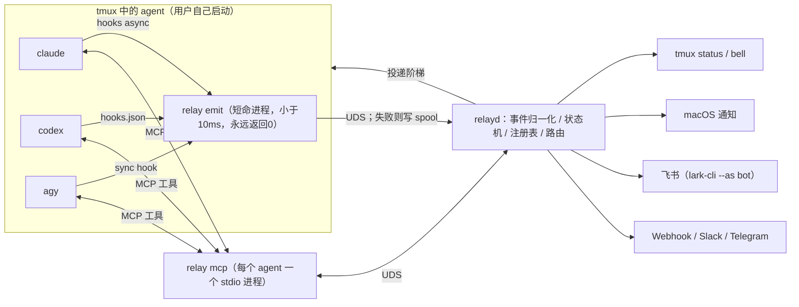
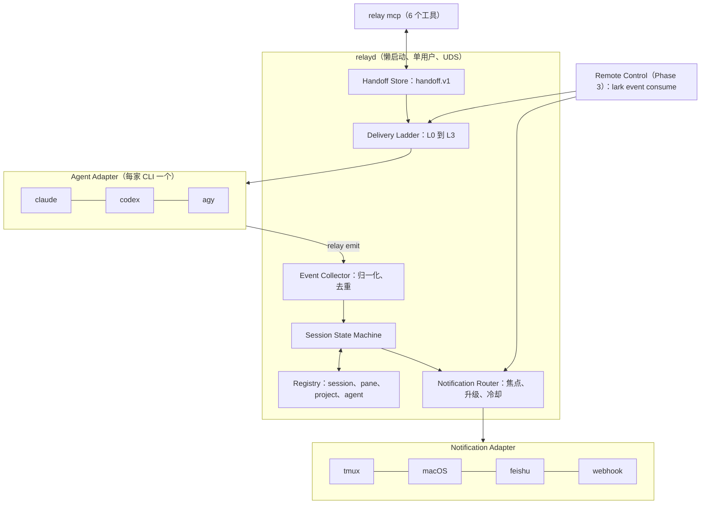

# 设计方案：异构 Coding Agent 的 tmux 协作与通知中枢

> **⚠️ 状态更新（v2）**：用户已对 §9 的决策问题拍板：零 Headless、Web 加飞书双控制面、角色分工、`review.v1` 防误报、Rust、按 AI 开发速度排期（board #15）。**正式架构以 [architecture.md](./architecture.md) 为准**。本文档保留为 v1 历史决策记录；其中 L3 Headless 投递、Go 技术栈等结论已被 v2 取代。

> 状态：**v1.1（已整合 verifier 第二阶段审核意见 board #9，待最终签核）**
> 输入：[research.md](./research.md)（scout 实测 + 开源调研，board #7）、verifier 边界用例备忘（board #6）、本人对 CLI 的抽查（`codex queue --help`、`claude agents --help`、`agy acp --help`、运行时冷启动计时）。
> 项目代号暂定 **`relay`**（仅占位，命名见 §9 Q5 旁注）。

---

## 0. TL;DR

- **定位**：一个 **BYO-tmux（沿用你自己的 tmux 布局）、非侵入、单二进制**的本地中枢。它通过官方 hook 观察 claude / codex / agy，把它们的状态归一化成统一事件，再按「你此刻是否在看」路由到 tmux / macOS / 飞书；同时提供一个**极简 MCP 工具面 + 结构化交接包（handoff）**，让 agent 之间不再靠复制粘贴传递上下文。
- **推荐形态**：**A′ = 本地 Hub（懒启动守护进程）+ Hook 采集器 + 通知插件 + MCP 桥**。从 C 借用 tmux pane 映射 / 焦点判定，从 B 借用 MCP 工具面，D（工作流编排）留作后期插件。
- **推荐技术栈**：**Go**。核心理由：agy 的 hook 是同步阻塞调用，`emit` 必须冷启动极快（本机实测裸 `node -e 0` 冷启动约 33ms、`python3 -c pass` 约 26ms，已超出 <30ms 预算）；另外单二进制便于 Homebrew / goreleaser 分发。
- **MVP 顺序**：Phase 1 先做「知道何时该回来看」（P2），顺带建立 *会话 ↔ pane ↔ 项目* 注册表；Phase 2 在这张表上做交接（P1）；Phase 3 做飞书双向（远程回复 / 审批）。

---

## 1. 产品定位与核心场景

### 1.1 要解决的两个痛点

| # | 痛点 | 本质缺失 |
|---|------|----------|
| P1 | 跨 agent 交互 / 上下文交接靠手动复制粘贴 | agent 之间没有**寻址**（谁是谁、在哪个 pane），也没有**结构化交接载体** |
| P2 | 后台 tmux 会话完成、出错或卡在审批 / 输入时没人知道 | 没有**统一事件模型**、**状态归一化**和**感知焦点的多渠道通知** |

### 1.2 定位与非目标

- **是**：常驻在你现有 tmux 工作流旁边的「感知 + 协作」层。装上就能用，卸载后不留痕迹。
- **不是**：
  - ❌ 不做 tmux 替代品，也不接管会话生命周期（不同于 agent-deck / AoE，它们需要通过自己的 TUI 来 spawn 会话）；
  - ❌ 不做重型编排框架（不同于 Gas Town），不强加 Mayor / Worker 这类概念体系；
  - ❌ 不把抓屏（ANSI 解析）当作数据通道（board #6 §3）；
  - ❌ 不改动用户现有配置中不属于自己的部分（如 codex `notify`、已有的 `PostToolUse` 格式化 hook）。

### 1.3 日常场景（用户故事）

| 场景 | 现在 | 有了 relay 之后 |
|------|------|-----------------|
| **S1 实现 → 评审**：claude 在 `%3` 写完功能，想让 codex 评审 | 复制 claude 总结 + 手敲 `git diff` → 粘贴到 codex pane | 在 claude 里说「交给 codex 评审」，agent 调用 MCP `create_handoff(to=codex, intent=review)`；或者人工执行 `relay handoff %3 → %5 --intent review`。codex pane 空闲时只收到一行指针「请用 relay 读取交接包 H-42」，正文通过 MCP 拉取 |
| **S2 离开工位**：跑着 3 个长任务去开会 | 回来逐个切 pane 巡检，发现有一个 20 分钟前就卡在审批 | 有人在看的 pane 不打扰；人离开后飞书收到卡片「claude@prome:2 需要审批：Bash `rm -rf build/`」，附项目、分支和最后一句回复 |
| **S3 上下文耗尽 / 换 agent 续跑**：claude 会话太长需要交接 | 手写 HANDOFF.md | `relay handoff --from %3 --new codex`：自动汇总 `last_assistant_message`、git 变更文件、未完成待办，以 headless 方式或在新 pane 中启动接手者 |
| **S4 设计 → 实现**：agy 产出设计，claude 实现 | 复制设计文档路径和要点 | agy 调用 `create_handoff(to=claude, intent=implement, files=[docs/x.md])`，claude 用 `read_inbox` 收取 |
| **S5 全局总览** | `tmux ls` 加肉眼判断 | `relay ls`：每个 agent 的 pane、项目、状态（working / waiting-permission / idle / error）、最近事件；同时写入 tmux status-bar（`@agent_state`） |
| **S6 并发写冲突预警** | 两个 agent 同时改同一个工作树，互相覆盖 | 注册表发现同一个 `cwd` 下有 2 个 `working` 状态的写会话时发出警告，并建议改用 `git worktree` 或把其中一个设为只读评审 |

---

## 2. 设计约束（实测事实 → 设计决策）

| 事实（来源） | 设计决策 |
|---|---|
| claude 有 `PermissionRequest` 和 `Notification`（`permission_prompt`/`idle_prompt`/`elicitation_dialog`），支持 `async` hook（research §1.2） | claude adapter 属于「精确」档；hook 设为 `async: true`，不阻塞回合 |
| codex `hooks.json` 有 `PermissionRequest`/`Stop`/`Interrupt`，**没有** `Notification`；新增条目受 `[hooks.state]` SHA-256 trust 约束；`notify` 已被 Computer Use 占用，与 hooks.json 共存（research §1.3，#6） | 只写 `hooks.json`，**永不碰 `notify`**；`doctor` 检测 trust 状态，并引导用户在 codex 内确认信任 |
| agy 只有 6 个事件，**没有审批 / 通知类 hook**；hook 同步阻塞（默认超时 30s）、stdin 字段为 camelCase、CWD 是 hooks.json 所在目录、stdout 必须输出 `{}`（research §1.4，#6） | agy adapter 的「审批等待」只能靠**启发式**（见 §5.4），事件带 `confidence` 字段；`emit` 必须冷启动极快且永远输出 `{}`、返回 0 |
| 本机 3 个 attached client 同时显示 `focused`（`focus-events off`），只有 `client_activity` 能区分（#6，research §1.6；本人实测 `focus-events off`） | 防打扰判定 = pane 可见 **且** `client_activity` 距今 < N 秒；高优先级事件在超时后**升级**，不会被永久压制 |
| claude 的 `#{pane_current_command}` 显示为 `2.1.299`；`$TMUX_PANE` 在 codex daemon（`daemon_auto_start=true`）或后台会话下可能缺失 / 错位（research §1.6, §3.4） | pane 映射分三层：hook 环境中的 `$TMUX_PANE` → PID 祖先链匹配 `pane_pid` → `cwd`+agent 类型模糊匹配；无法确定时标记为 `pane: unknown`，通知照常发送，只是无法跳转 |
| `send-keys` 会撞上 copy-mode（`pane_in_mode=1`）、全屏 TUI 或用户正在输入（#6 §1） | 注入是**最后一级**投递手段，且只注入一行短指针；注入前做三重检查（见 §5.3） |
| 三家都支持 stdio MCP 客户端（research §1.1） | 交接正文走 MCP 拉取，这是三家能力的最大公约数 |
| codex 有原生 `codex queue --thread <id> --message`（本人 `--help` 实测） | codex adapter 优先用原生投递，不走 send-keys |
| 已有 `PostToolUse` 自动格式化 hook，多 agent 共写一个工作树时会互相覆盖（#6 §3） | 交接包带 `mode: read-only | write`；注册表检测同一工作树中的多个写会话并预警 |
| lark-cli 支持 `--as bot` 发送（带 `--idempotency-key`），`event consume card.action.trigger` / `im.message.receive_v1` 通过长连接接收；子进程需保持 stdin 打开、等待 stderr ready 信号、用 SIGTERM 退出（research §1.5） | 飞书单向通知进 MVP；双向交互放在 Phase 3，由守护进程托管 `consume` 子进程 |
| 本机三家 CLI 常以跳过审批的参数启动（#6 §2） | 「回合完成 / 出错 / 长时间无进展」与「等待审批」同等重要；远程审批的价值相应下降，不进 MVP |

---

## 3. 四种候选产品形态

### A. 本地 Hub 守护进程 + Hook 采集器 + 通知插件 + MCP 桥



- **P2**：事件驱动，状态最准（claude 和 codex 有精确的审批信号）。
- **P1**：MCP 拉取交接包，加上分级投递唤醒。
- 优点：两个痛点都能覆盖；插件边界清晰（Agent Adapter / Notifier）；人用 CLI 也能直接操作。
- 缺点：有常驻进程（可用懒启动缓解）；需要为三家维护 hook 安装器（schema 各不相同）。

### B. MCP-First Agent Mesh + 轻量通知

```
每个 agent 挂载同一个 relay-mcp（stdio），共享 ~/.local/state/relay/*.sqlite
  tools: register / send / inbox / handoff / reserve_files / notify_human
通知：agent 主动调用 notify_human；Stop hook 兜底
```

- 优点：没有守护进程，概念最少；交接由 agent 在语义层面完成（类似 mcp_agent_mail）。
- 缺点：**结构性缺陷**：agent 卡在审批或已经停下时根本不会调用工具，所以 P2 只能靠额外的 hook 兜底，最后还是会退化成 A。此外它依赖模型「记得」调用工具，而且工具一多就会撑大 prompt（mcp_agent_mail 有 45+ 个工具，见 research §2）。

### C. tmux 控制平面 / TUI Supervisor + 文件 Mailbox

```
relay tui ── 由 relay 在 pane 中 spawn 各 agent（掌握完整 pane 映射）
          ├─ 状态面板：capture-pane 特征匹配 + pane 活动标志
          ├─ 文件 mailbox：.relay/mailbox/<agent>/*.md
          └─ 注入：send-keys / paste-buffer
```

- 优点：所见即所得；对 agent 零配置；天然掌握 pane 映射和焦点。
- 缺点：抓屏解析脆弱，任何一家 TUI 改版都会失效；要求按它的方式启动 agent，**违反 BYO-tmux 原则**（research §2 的采用规律第 1 条）；TUI 本身维护成本高；与 agent-deck、ccmux 同质化严重。

### D. 统一 CLI 编排器 / Workflow Runner

```
relay run pipeline.yaml
  - claude -p "设计"        --output-format json → artifact
  - codex exec "实现"  --json -o out.md           → diff
  - agy -p "评审 diff" --output-format json       → report
```

- 优点：可复现、可放进 CI；交接是显式产物；完全基于结构化输出，不碰 TUI。
- 缺点：headless 冷启动会丢失交互上下文；**完全不解决交互式会话的通知问题（P2）**；与用户「在 tmux 里和 agent 对话」的日常习惯脱节。

---

## 4. 对比矩阵

评分 1–5，5 为最好。

| 维度 | A Hub+Hook+MCP | B MCP Mesh | C tmux TUI | D Runner |
|---|:-:|:-:|:-:|:-:|
| P2 通知准确度（完成 / 审批 / 出错） | **5**（agy 审批为启发式） | 2 | 3（抓屏） | 1 |
| P1 交接质量（结构化、不丢上下文） | **4** | 4 | 2 | 4（但会冷启动） |
| 不改变用户工作流（BYO tmux） | **5** | 5 | 2 | 2 |
| 非侵入 / 可逆安装 | 4（需写三家 hook） | 4 | 5 | 5 |
| 对 CLI 版本升级的鲁棒性 | 4（hook 是官方接口） | 4 | 1 | 4 |
| MVP 工作量（越小越好） | 3 | 4 | 2 | 4 |
| 社区可扩展性（插件边界） | **5** | 3 | 2 | 3 |
| 与现有开源项目的差异化 | **5**（异构 + 交接 + 飞书双向） | 2（mcp_agent_mail） | 1（agent-deck / ccmux） | 2 |
| **合计** | **35** | 28 | 18 | 25 |

**结论**：A 是唯一能同时覆盖 P1 和 P2、又不劫持工作流的形态。B 的 MCP 工具面和 C 的 pane 感知能力应作为 A 的组件吸收，D 作为 Phase 3+ 插件（`relay run` 复用同一套 adapter 的 headless 调用）。

---

## 5. 推荐架构 A′ 与核心模块抽象



### 5.1 Agent Adapter

```go
type AgentAdapter interface {
    Name() string                                   // "claude" | "codex" | "agy"
    Detect() (Capabilities, error)                  // 版本、hook 支持度、headless 参数
    Install(scope Scope) (Plan, error)              // 先 dry-run 输出 diff；落盘前备份；只追加带标记的条目
    Uninstall(scope Scope) error                    // 只删除带 relay 标记的条目
    Doctor() []Finding                              // 例如 codex trust 未确认、agy 没有 hooks.json
    Normalize(hookEvent string, stdin []byte) (Event, HookReply) // HookReply：agy 返回 "{}"
    Deliver(target Session, msg string) error       // 原生投递（codex queue）；不支持则返回 ErrUnsupported
    Headless(req HeadlessRequest) *exec.Cmd          // claude -p / codex exec / agy -p
}
```

安装原则：**幂等追加 + 标记 + 备份 + dry-run 预览**；scope 可选 `user`（`~/.claude/settings.json` 等）或 `project`（`.claude/settings.local.json`、`.agents/hooks.json`）。codex 只写 `hooks.json`。

### 5.2 Hook / Event Collector 与统一事件模型

```jsonc
// relay.event.v1
{ "v":1, "id":"ulid", "ts":"…", "agent":"claude|codex|agy",
  "session":"<session_id|conversationId>", "pane":"%12|null", "cwd":"/repo", "git_branch":"feat/x",
  "kind":"session_start|working|turn_complete|needs_permission|needs_input|error|interrupted|session_end",
  "confidence":"exact|heuristic", "is_subagent":false,
  "detail":{ "tool":"Bash", "summary":"<last_assistant_message 截断>", "reason":"ERROR" },
  "raw_ref":"<transcript_path>" }
```

原生事件到统一 `kind` 的映射：

| kind | claude | codex | agy |
|---|---|---|---|
| session_start | `SessionStart` | `SessionStart` | `SessionStart` |
| working | `UserPromptSubmit` | `UserPromptSubmit` | `PreInvocation` |
| needs_permission | `PermissionRequest` / `Notification:permission_prompt`（exact） | `PermissionRequest`（exact） | **启发式，可选开启**：有副作用的工具触发 `PreToolUse` 后，N 秒内没有 `PostToolUse`，且 pane 无输出变化（见 §5.4） |
| needs_input | `Notification:idle_prompt` / `elicitation_dialog` | —（用 `turn_complete` 代替） | — |
| turn_complete | `Stop`（忽略 `SubagentStop`） | `Stop` | `Stop` 且 `fullyIdle=true`，`terminationReason ∈ {NO_TOOL_CALL, INJECTED_RESPONSE}` |
| error | `StopFailure` | **有限 / 尽力而为**：codex 没有 `StopFailure`；交互式 TUI 出错后进程不会退出，relayd 也不是它的父进程，读不到退出码。只能对 `last_assistant_message` / `transcript_path` 末尾做可选检查；Phase 3 可通过 `app-server` 获得精确信号 | `Stop` 且 `terminationReason ∈ {ERROR, MAX_INVOCATIONS, MAX_TOKEN_BUDGET_EXCEEDED}` 等错误或超限类原因 |
| interrupted | — | `Interrupt` | `Stop` 且 `terminationReason=USER_CANCELED` |
| session_end | `SessionEnd` | `SessionEnd` | 启发式：pane 进程消失 |

**`relay emit` 契约**（决定技术栈的关键路径）：
1. 读取 stdin 和环境变量（`$TMUX_PANE`、`$PPID`），调用 `Normalize`；
2. 通过 UDS 非阻塞发给 relayd（50ms 超时）；失败则原子追加写入 `~/.local/state/relay/spool/*.jsonl`，并 detached 拉起 relayd（懒启动，类似 lark-cli bus daemon 的做法）；
3. 无论成功与否，**立即向 stdout 输出 adapter 指定的回复（agy 为 `{}`）并返回 0**。绝不调用网络或 lark-cli。

### 5.3 Session / Transport 层：注册表 + 投递阶梯

**注册表**：`session_id ↔ agent ↔ pane_id ↔ cwd ↔ git root ↔ state ↔ last_event`。Phase 1a 用原子写的 JSON 快照，Phase 2 交接需要索引时再引入 SQLite（WAL 模式）。同时把 `@agent_state` / `@agent_name` 写入 pane 选项，供 status-bar 显示。

**投递阶梯**（把消息或交接送达目标 agent，逐级降级）：

| 级别 | 方式 | 适用 | 安全性 |
|---|---|---|---|
| L0 收件箱 | 写入 handoff store，由目标 agent 调用 MCP `read_inbox` 拉取；人可以说「看下 inbox」 | 全部 | 最安全，但需要有人触发 |
| L1 原生投递 | `codex queue --thread <id> --message …`（可加 `--resume`）；后续可接 `agy acp` / `codex app-server` | codex（`--help` 已确认），其他待评估 | 安全。**待实测**：该命令经 app-server daemon 路由，对正在运行的交互式 TUI 是立即唤醒还是要等 resume 后才生效，需在 Phase 0/2 实测 |
| L2 守护注入 | `tmux load-buffer` + `paste-buffer` + Enter，**只注入一行指针**（如「relay: 你有交接包 H-42，请调用 read_inbox」） | 目标 pane 已映射 | 必须同时满足：状态机为 `turn_complete`/`idle` **且** `pane_in_mode=0` **且** 目标 pane 所在 client 的 `client_activity` 超过 N 秒（用户没在打字）；否则退回 L0 |
| L3 Headless 新会话 | `claude -p` / `codex exec --json -o` / `agy -p --output-format json`，以交接包作为 prompt | 一次性任务（评审、问答） | 不碰交互会话，但没有上下文 |

> 核心原则：**正文走 MCP 或文件，终端只传指针**。这样把 send-keys 的脆弱面压缩到一行固定文本。

### 5.4 agy 审批等待的启发式（如实说明局限）

- 信号：`PreToolUse(tool=T)` 到达后，`N`（默认 20s）秒内没有对应的 `PostToolUse`，且 pane 内容哈希不再变化（`capture-pane` 只用来**判断是否有变化**，不解析内容）。这时判定为 `needs_permission?`（confidence=heuristic）。PreToolUse 先于 agy 的审批提示触发，因此这个时序可用（board #9 已确认）。
- **同步开销**：agy 的 hook 是同步 `sh -c`。如果给所有工具都挂 Pre/PostToolUse，每次工具调用（包括只读工具）都会多 2 次同步进程调用。因此：
  - matcher **只匹配有副作用的工具**（如 `run_command|write_file|edit_file`）；
  - agy 的 Pre/PostToolUse 注册**默认关闭，需显式开启**（`relay install agy --permission-heuristic`）。默认只安装 `SessionStart`/`PreInvocation`/`Stop`。用户常用 `--dangerously-skip-permissions` 或 auto 模式时不应开启。
- **误报**：静默运行的长命令（`cargo build`、`pytest`、`swarm_wait`）在 20 秒后也会触发。因此通知文案明确写「可能在等待审批或执行长命令」，事件带 confidence=heuristic，路由按低优先级处理（不立即升级到飞书）。
- 远期：`agy acp` 的 ACP 协议里有原生的 permission 请求，可以把 agy 升级到 exact 档（需要 relay 作为 ACP client 托管 agy，属于 Phase 3 的可选形态）。

### 5.5 Handoff / Context Protocol（`handoff.v1`）

存储为 Markdown 加 YAML front matter（人可读、可 git 管理），默认路径 `<repo>/.relay/handoffs/H-<ulid>.md`（建议加入 `.gitignore`；可配置为放到 `~/.local/state`）：

```yaml
---
id: H-01JD…
from: { agent: claude, session: 7f3…, pane: "%3" }
to:   { agent: codex, session: null, pane: "%5" }   # session 为 null 表示由 L3 新开会话
intent: review            # review | implement | continue | ask | fyi
mode: read-only           # read-only | write（并发写保护依据）
repo: { root: /Users/…/proj, branch: feat/x, base: a1b2c3, head: d4e5f6, dirty: [src/a.go] }
refs: [docs/design.md, "transcript:~/.claude/projects/…/7f3.jsonl"]
status: pending           # pending | delivered | acked | done
---
## 目标
## 已完成 / 结论
## 关键决策与理由
## 待办 / 验收标准
## 需要对方回答的问题
```

生成方式有两种：(1) agent 调用 MCP `create_handoff` 自行撰写（语义最好）；(2) 人工执行 `relay handoff`，自动填充 `last_assistant_message`、`git diff --stat`、变更文件和 transcript 引用（零模型成本）。

**MCP 工具面（控制在 6 个）**：`list_agents`、`send_message`、`read_inbox`、`create_handoff`、`get_handoff`、`notify_human`。MCP server 是 `relay mcp`（stdio），只是 relayd 的薄客户端。

**MCP 自我身份解析（「我是谁」）**：codex 默认 `daemon_auto_start=true`，stdio MCP 由共享的 `app-server` 拉起；agy 的 stdio MCP 由 Language Server 拉起。这两种情况下 `relay mcp` 进程拿到的 `$TMUX_PANE` 都可能缺失或过期（与 §2 第 5 行同理），**不能依赖它**。解析顺序如下：
1. 注册时写入的显式参数：`relay mcp --agent codex`（每家 MCP 配置各写一份，从而确定 agent 类型）；
2. 用 MCP `roots` 或进程 `cwd`，到注册表中匹配「同一 agent 类型 + 同一项目 + 最近活跃」的会话（hook 事件里有精确的 `session_id`+`cwd`+pane）；
3. 仍有歧义（同一项目里开了两个 codex）时，工具调用接受可选的 `from_session` 参数；或者返回候选列表，让 agent 或人确认一次，确认后在本次 MCP 连接内缓存；
4. `$TMUX_PANE` 只作为辅助提示，不作为唯一依据。

### 5.6 Notification Adapter 与路由

```go
type Notifier interface {
    Name() string
    Send(ctx context.Context, n Notification) (MessageRef, error)
    Update(ctx context.Context, ref MessageRef, n Notification) error // 可选：飞书卡片用 im messages patch，text/post 消息用 +messages-edit
}
```

内置 `tmux`（status、`display-message`、bell）、`macos`（`osascript`；可选 terminal-notifier，点击后跳回 pane）、`feishu`（`lark-cli im +messages-send --as bot --markdown|--msg-type interactive --idempotency-key <event_id>`）、`webhook`（通用 JSON，Slack / Telegram 可通过社区插件或 webhook 模板接入）。

**路由策略**（用户可在 `~/.config/relay/config.toml` 中覆盖）：

1. **看着就不打扰**：目标 pane 可见（session attached + window active + pane active）**且**该 client 的 `client_activity` 距今 < 90s，则只更新 tmux 状态。
2. **升级链**：`needs_permission` / `error` → 立即发 tmux + macOS，若 3 分钟内状态没有变化 → 发飞书；`turn_complete` → tmux 加 macOS，人离开超过 10 分钟后才发飞书汇总。
3. **去重 / 冷却**：同一个 `(session, kind)` 在冷却窗口内只发一次；过滤 subagent 事件（claude `SubagentStop`、agy `fullyIdle=false`）；飞书使用 `idempotency-key` 防止重试导致重复发送。
4. **状态回写**：状态解除后，用 `Update` 把飞书卡片改为「✅ 已处理」，避免手机上积压过期告警。注意 API 区分（board #9 实测）：`lark-cli im +messages-edit` **只适用于 text / post 消息**；主动更新**交互卡片**需用 `lark-cli im messages patch --as bot --message-id om_xxx`（14 天内有效）；由卡片按钮回调触发的更新，用回调里的 `token` 调 `/open-apis/interactive/v1/card/update`（30 分钟内最多 2 次）。

### 5.7 Remote Control（可选，Phase 3）

- relayd 托管 `lark-cli event consume im.message.receive_v1 --as bot` 和 `card.action.trigger`（保持 stdin pipe 打开、等待 stderr 输出 `[event] ready`、退出时发 SIGTERM）。
- **远程回复**（价值高）：在飞书话题里回复 → 根据卡片映射找到目标 session → 走投递阶梯 L1 / L2。
- **远程审批**（价值中等，风险高）：**官方路线已验证（board #9）**：claude 2.1.299 的 `PermissionRequest` hook 可以返回 `hookSpecificOutput: {hookEventName: "PermissionRequest", decision: {behavior: "allow"|"deny"}}`；codex 0.167.2 的 `permission-request.command.output` 同样支持 `behavior: "allow"|"deny"`。实际注意事项：
  - hook 必须同步等待飞书回调，需要调大该 hook 的 `timeout`。超时后返回空结果，退回本地终端提示；
  - **竞态**：本地终端和远程卡片可能同时批准，需要做到「先到先得」，并回写卡片标明「已在本地处理」；
  - 安全：卡片展示完整的工具名和参数，校验 `operator_id` 在白名单内，默认拒绝。
  - agy 没有这个能力（没有 PermissionRequest hook）。
  - 仍然放在 Phase 3，默认关闭、需显式开启，并且只对 claude / codex 开放。

---

## 6. 技术栈推荐：Go

| 维度 | **Go（推荐）** | TypeScript (Node) | Rust | Python |
|---|---|---|---|---|
| `emit` 冷启动（agy 同步 hook 的关键路径） | 原生二进制，约几毫秒（同类 `/bin/echo` 实测 2.3ms） | **裸 `node -e 0` 实测 32.8ms**，加载依赖后会更慢，超出预算 | 约几毫秒 | **裸启动实测 25.7ms**，加载依赖后会更慢 |
| 分发 | 单静态二进制；goreleaser 加 Homebrew tap、`go install` | npm（与 codex / lark-cli 的安装方式一致） | 单二进制，但交叉编译和 CI 较重 | pipx / uv，环境问题多 |
| MCP SDK | 官方 `modelcontextprotocol/go-sdk` | 官方 SDK 最成熟 | 社区 / 官方 rmcp | 官方 SDK |
| 进程 / UDS / 信号 / tmux 子进程 | 一等公民 | 可以 | 一等公民 | 可以 |
| TUI（后期） | Bubble Tea（agent-deck 同栈） | Ink（ccmanager 同栈） | ratatui | Textual |
| 贡献者门槛 | 低 | 最低 | 高 | 低 |
| 同类项目 | agent-deck、gastown | ccmanager | AoE、mcp_agent_mail_rust | — |

**理由**：(1) agy 的所有 hook 都是同步执行：`PreInvocation`/`Stop` 每轮都会触发，开启审批启发式后，每次有副作用的工具调用还要多 2 次。`emit` 的冷启动时间会直接叠加到 agent 的主循环上，而 Node / Python 的裸启动已经吃掉整个预算；(2) 「`brew install` 后只有一个二进制」是这类 CLI 工具被采用的关键（research §2 规律 4）；(3) 守护进程、UDS、子进程托管（lark-cli consume）、SQLite（可用 `modernc.org/sqlite` 纯 Go 实现，免 CGO）都是 Go 擅长的领域。

**代价**：本机未安装 Go（`brew install go` 即可）；codex `app-server generate-ts` 生成的类型对 TS 更友好（Phase 3 才需要，可以用 `generate-json-schema` 再生成 Go 类型）。**若坚持 TS**：可以把 `emit` 写成极小的 POSIX sh / C shim（只负责转发到 UDS），其余部分用 TS，但这样就变成双语言仓库。

---

## 7. 路线图

| 阶段 | 主题 | 交付物 | 验收标准 |
|---|---|---|---|
| **Phase 0**（约 1 周） | 规格先行 | `relay.event.v1` 和 `handoff.v1` 的 JSON Schema；Adapter / Notifier 接口；只读的 `relay doctor` | doctor 在本机正确报告三家 CLI 的 hook 状态、codex trust、tmux focus-events 状态 |
| **Phase 1a MVP**（约 2 周） | **知道何时该回来看（P2）核心** | `emit` + 懒启动 relayd + 三家 adapter 的 `install/uninstall/doctor`（dry-run、备份、标记；agy 默认不装 ToolUse hook）+ pane 映射 + 状态机 + 通知（tmux、飞书单向）+ `relay ls` + 感知焦点的抑制。状态用**原子写的 JSON 快照**（不引入 SQLite） | 在本机 5 个 session、25+ 个 pane 的真实负载下：claude / codex 审批 5 秒内送达；在看的 pane 不推送；卸载后三家配置与安装前 diff 一致 |
| **Phase 1b** | P2 完善 | macOS / webhook notifier、升级链与冷却策略配置、`relay watch`、飞书卡片状态回写（`messages patch`）、agy 审批启发式（可选开启） | 离开工位一小时，只收到需要处理的告警，没有重复或过期告警 |
| **Phase 2** | **交接（P1）** | `relay mcp`（6 个工具，含身份解析）+ `handoff.v1` 存储（此时引入 SQLite 作为索引，正文仍是 Markdown 文件）+ `relay handoff` CLI + 投递阶梯 L0–L3（含 `codex queue`）+ 并发写预警 | S1 / S3 / S4 场景全程零复制粘贴；L2 注入从不打进 copy-mode 或用户正在输入的 pane |
| **Phase 3** | 远程与深度集成 | 飞书双向（远程回复、卡片状态回写、实验性远程审批）；`agy acp` / `codex app-server` 深度 adapter；可选 TUI 看板；`relay run`（形态 D）插件 | 手机上回复飞书即可推动 agent 继续工作 |

> 为什么先做 P2：范围小、单独就有价值、容易验证；而 P2 建立的 **session ↔ pane 注册表**正是 P1 寻址的前提。

---

## 8. 主要风险

| 风险 | 缓解 |
|---|---|
| 三家 CLI 快速迭代，hook schema 变化 | adapter 做版本探测（`Detect`）；用契约测试保存真实 stdin 样本（fixtures）；`doctor` 提示不兼容 |
| codex trust 机制让「一键安装」变成两步 | `install` 完成后打印明确指引；`doctor` 检测 `[hooks.state]` |
| agy 审批检测只能启发式 | 显式标注 `confidence`；用户使用跳过审批参数时自动关闭；Phase 3 走 ACP |
| `$TMUX_PANE` 缺失（codex daemon、后台会话） | 三层映射，退化为 `pane: unknown`，通知照常发送 |
| 用户配置损坏导致失去信任 | dry-run diff + 备份 + 只操作带标记的条目 + 卸载后校验 |
| 产品范围膨胀 | MVP 严格只做 P2；MCP 工具不超过 6 个；不做 TUI |

---

## 9. 需要你拍板的决策问题

1. **MVP 优先级**：按推荐 **先 P2（通知）再 P1（交接）**？还是先做 P1，或者两者都只做最小闭环、同时推进？
2. **技术栈**：**Go**（推荐，冷启动快、单二进制）还是 **TypeScript**（生态熟、npm 分发，但 `emit` 需要额外的 shim）？
3. **交接的默认投递强度**：只做 L0（agent 主动拉取，最安全），还是默认允许 L2 守护注入一行指针（体验最顺，但会向你的 pane 自动输入）？
4. **飞书的角色**：MVP 只做**单向通知**，还是把**远程回复**（不含审批）也纳入 Phase 1？
5. **产品边界**：坚持 **BYO-tmux、不做 TUI、不接管会话启动**？还是希望后续提供 `relay spawn` / TUI 看板（向 agent-deck 方向靠拢）？

> 旁注（不阻塞）：`relay` 只是占位名；正式命名前需要检查 GitHub / Homebrew / npm 是否重名。
